# tidyfiles

[](https://github.com/pietro379/tidyfiles/actions/workflows/ci.yml)


Karışık bir klasörü (örneğin İndirilenler) dosya türüne ve isteğe bağlı olarak tarihe göre düzenleyen, **geri alınabilir** bir komut satırı aracı. Python ile yazıldı, harici bağımlılığı yoktur.

İndirilenler klasörü zamanla yüzlerce dosyayla dolar ve bir şey bulmak zorlaşır. tidyfiles tek komutla bunu düzene sokar; yanlış giderse `undo` ile her şey olduğu gibi geri gelir.

<p align="center">
  
</p>

<p align="center"><sub>Gerçek bir çalıştırmanın çıktısı (klasör yolu kısaltıldı).</sub></p>

## Özellikler

- **Türe göre düzenleme:** Görseller, Belgeler, Videolar, Müzik, Arşivler, Kurulum, Kod ve Diğer klasörlerine ayırır.
- **Tarihe göre alt klasör:** `--by-date` ile her kategori içinde `YYYY-AA` klasörleri oluşturur (dosyanın değiştirilme tarihine göre).
- **Kuru çalıştırma:** `--dry-run` ile hiçbir dosyayı taşımadan planı gösterir.
- **Geri alma:** Her düzenleme klasörde kaydedilir; `undo` son işlemi geri alır ve boşalan klasörleri temizler.
- **Güvenli davranış:** Aynı isimli dosyaların üzerine yazmaz (`ad (1).uzantı` olarak kaydeder). Gizli dosyalara, alt klasörlere ve henüz inen dosyalara (`.crdownload`, `.part`, `.tmp`) dokunmaz.

## Kurulum ve Kullanım

Python 3.10 veya üzeri gerekir.

```bash
# Önce ne olacağına bak
python -m tidyfiles organize "C:\Users\ad\Downloads" --dry-run

# Düzenle (isteğe bağlı: tarihe göre alt klasörlerle)
python -m tidyfiles organize "C:\Users\ad\Downloads" --by-date

# Son düzenlemeyi geri al
python -m tidyfiles undo "C:\Users\ad\Downloads"
```

İsteğe bağlı olarak `pip install .` ile kurup doğrudan `tidyfiles organize ...` komutunu da kullanabilirsin.

## Testler

```bash
python -m unittest discover -s tests -v
```

Testler geçici klasörlerde çalışır; kategori eşleme, çakışma yönetimi, tarihli düzenleme, geri alma, komut satırı akışı ve ekrana yazılan çıktıyı kapsar. GitHub Actions, her gönderimde testleri Ubuntu ve Windows üzerinde Python 3.10 ve 3.12 ile çalıştırır.

## Proje Yapısı

```text
tidyfiles/
├── categories.py   # Uzantı -> kategori eşlemesi, atlanacak uzantılar
├── organizer.py    # Planlama, taşıma ve geri alma mantığı
├── cli.py          # Komut satırı arayüzü (argparse)
└── __main__.py     # python -m tidyfiles giriş noktası
tests/              # unittest ile birim testleri
```
